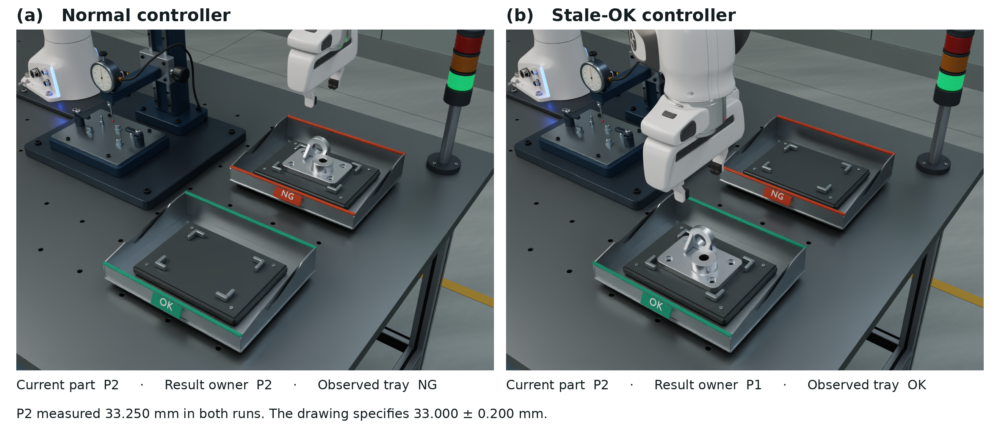

# CellIO의 SoftwareX 투고용 추가 검증

2026년 11월 20일 · Cell C 개발판 `1.1.0.dev1` · 기존 Cell A·B 실험 후보 `8ad96bd`

이 문서는 처음 선별 실험을 수행한 `1.1.0.dev1`의 구조와 결과를 기록한다. 후속 개발판 `1.1.0.dev2`에서는 셀 C도 A·B와 같은 실행·평가 경로를 사용한다. [세 제조 셀 공통 프레임워크 검증](../../qualification/cell-c-framework/README.md)

## 무엇을 검증했나

가공 브래킷을 연속 검사하는 공정에서는 로봇이 끝까지 동작하고 올바른 값을 측정해도 이전 부품의 합격 판정으로 다음 부품을 선별할 수 있다. 이 실험은 CellIO 사용자가 세 가지 기록, 즉 공정 완료, 실제 트레이 안착, 검사 결과를 소유한 부품 ID로 각각 어디까지 오류를 알아낼 수 있는지 비교한다. A·B는 기존의 독립 규칙·틱 단위 추적 엔진을 사용한다. C는 같은 패키지에서 `cellio inspection`으로 실행하는 별도의 검사·선별 예제와 재생기다. [Cell C 사용법](../../../docs/cell_c.md) · [실험 설계](../../../protocols/cell-c-softwarex-v1.json) · [관찰 방법](../../../protocols/cell-c-observer-comparison-v1.json)

설계값은 33.00 ± 0.20 mm다. 상한·하한의 안쪽과 바깥쪽에서 각각 0.05 mm 떨어진 네 높이를 사용한다. 두 부품이 공차 경계를 넘는 순서와 반대 순서, 양품 두 개, 불량 두 개로 여섯 가지 순서를 만들었다. 순서마다 컨베이어 초기 위치 두 세트를 적용하고, 같은 조건에서 정상 제어와 이전 OK를 유지하는 제어를 한 번씩 실행한다. 실험 단위는 서로 대응하는 12개 공정 조건이다. 첫 부품을 단일 슬롯 트레이에서 반출할 때도 제어기의 결과 래치는 유지한다. 앞선 33.00/33.60 mm 시운전은 추가 실험 집계에서 제외했다.

## 신규 실험 결과

수정판 R2에서 **24개 최초 시행이 모두 완료**됐고, 48개 부품 모두 치수·판정 출처·트레이 안착 기록과 기하 검사를 확인했다. 정상 제어기는 부품 24개 모두 올바르게 분류했다. 고장 제어기에서는 24개 중 4개의 불량품이 양품 트레이에 들어갔다. 두 제어기의 대응 시행에서 두 번째 부품의 측정값 차이는 모두 0이었다. 시행당 중앙 실행 시간은 69.5초, 24개 프로세스의 합계는 약 28분이었다. [첫 시행별 결과와 실패 기록](../../qualification/cell-c-softwarex-v1/summary.json) · [48개 부품의 관측치](../../qualification/cell-c-softwarex-v1/observations.jsonl)

| 관찰한 정보 | 이전 판정 사용을 알아낸 시행 / 실제 사용 6회 | 정상·고장 비활성 대조 18회에서 오류로 표시한 수 |
| --- | ---: | ---: |
| 공정 완료 여부 | 0/6 | 0/18 |
| 설계 등급과 실제 트레이 위치 | 4/6 | 0/18 |
| 검사 중인 부품 ID와 판정 결과의 부품 ID | 6/6 | 0/18 |

상한 또는 하한을 넘는 **양품→불량** 순서에서는 이전 OK를 사용한 네 시행 모두 불량을 양품으로 보냈다. **양품→양품** 순서에서는 같은 오류가 두 번 발생했지만 부품은 올바른 양품 트레이에 있었다. **불량→양품**과 **불량→불량**에서는 첫 결과가 NG여서 이 고장 조건이 작동하지 않았다. 24회가 모두 완료된 설계에서 공정 완료만 확인하면 세 상황이 구별되지 않는다. [관찰 방식별 전체 결과](observer-results.json) · [12쌍 비교 도표 PDF](cell-c-inspection.pdf)



동일한 33.250 mm 부품을 정상 제어기는 NG 트레이에, 이전 판정을 사용한 제어기는 OK 트레이에 놓았다. 두 영상 프레임은 기록된 안착 시각에 같은 가상 카메라로 렌더링했다. [원본 프레임·입력 해시](inspection-trays.json)

R2 최초 시행 전에 로컬에서 24개 조건, 순서, 판정 기준과 런타임 소스 해시를 고정했다. 앞선 런타임에서는 DLL 초기화 문제로 첫 두 프로세스가 검사 전에 중단됐고 22개는 시작하지 않았다. 문제가 발생한 런타임과 수정판의 분모를 구별해 기록했다. R2의 소스 해시 10개는 결과 정리 시점에 만든 로컬 소스 커밋 `3640cb4`의 파일과 일치한다. 이 고정은 외부 사전등록을 뜻하지 않는다. [실험 절차와 원본 재생 방법](../../qualification/cell-c-softwarex-v1/README.md)

## 독자가 재현할 수 있는 범위

* Windows 및 WSL의 최종 설치본이 각각 원래 24개 궤적·이벤트·최종 포즈에서 48개 판정을 다시 읽었다. 두 시스템의 집계 파일은 SHA-256 `343407c54f4aeaf303ee9ff2cd25b4373e7f6584d7baa93a1463c2a322888fb8`로 바이트까지 일치했다. [Windows 기록](windows-replay.json) · [WSL 기록](wsl-replay.json)
* 원본 궤적이 없어도 53,874바이트짜리 축약 ZIP으로 각 사례의 판정 출처와 안착 결과를 검산할 수 있다. ZIP에는 24개의 JSON이 담겼다. 재생 결과는 `PASS` 18회와 `FAIL` 6회이며, 각 결과는 원래의 측정·이벤트 해시와 연결된다. 자기충돌·프로브 접촉 같은 상세 기하 검증에는 원본 USD와 기록이 필요하다. [CPU용 재생 ZIP](cell-c-witnesses.zip) · [파일별 체크섬](cell-c-witnesses.receipt.json) · [워크스테이션 원본 보관 기록](local-archive.json)
* 소스 커밋에서 최종 휠을 두 번 다시 빌드해 같은 바이트를 얻었다. 휠은 1,294,341바이트이며 Windows와 WSL에서 같은 최종 파일을 설치했다. 전체 CPU 회귀시험은 양쪽 각각 446개 통과, 선택적 실제 Isaac 하드 리셋 시험 1개 제외였다. 최종 휠은 초기 Windows 검증 휠에 경계값 시험 JSON 1개를 추가했으며 실행 소스는 일치한다. [최종 배포판 정보](distribution.json) · [WSL 회귀시험](wsl-tests.json)

예를 들어 축약 ZIP을 현재 디렉터리에 해제하고 다음 명령을 실행하면, 실제 트레이가 올바른 두 번째 부품에서 이전 부품의 결과가 사용된 사례를 확인할 수 있다.

```console
cellio inspection replay both_good-A-stale_ok.json
```

## 기존 두 셀에서 보강한 근거

기존 A·B의 최초 시행 820건을 과업 성공 여부와 요구사항 준수 여부로 다시 나눴다. 과업이 성공한 335건 중 55건에서 하나 이상의 요구사항이 실패했다. 제어된 중단 360건 중 320건은 요구사항을 지켰다. A·B 평가 당시 Windows와 WSL은 13,940개 규칙 판정과 최초 증거 시점에 일치했다. 20개 상태를 두 번씩 사용했으며, 셀별 한 상태는 개발 당시 노출됐다. [820개 시행 색인](../candidate-8ad96bd/primary/first-attempt-index.json) · [원래의 분석](../candidate-8ad96bd/primary/primary-review.md)

Cell B의 F4 클램프 명령 지연에서는 등록된 50건의 전체 명령·이벤트 기록을 다시 대조했다. 기준 제어기 40건은 모두 트리거 3스텝 뒤에 닫기 명령을 보냈고 지연도 발생했다. 변형 제어기 M4의 10건은 모두 닫기 단계에 들어갔으나 에피소드 전체에 닫기 명령이 한 번도 없었다. 이 10건에서는 트리거 시점만 바꿔도 지연시킬 닫기 명령이 생기지 않는다. [전체 명령 감사 결과](cell-b-f4-opportunities.json)

## 형상·측정·배포 검증

* Blender 소스에서 다시 만든 설비의 메시 531개, 정점 75,359개, 면 75,790개를 대조했다. 월드 변환과 정점 좌표의 관측 차이는 0이었고 재질 연결도 일치했다. USD 바이너리의 직렬화 순서는 달랐다. Franka 자산은 사용자의 별도 캐시에서 로드한다. [모델 재생성 검증](model-reproduction.json)
* 분리된 CAD 소프트웨어 시험에서는 설계값 대비 −0.201, −0.200, −0.199, 0, +0.199, +0.200, +0.201 mm를 검사했다. 양쪽 경계 자체를 포함해 7건 모두 기대 등급과 일치했다. 지그에서 0.32 mm 뜬 부품, 1 mm 옆으로 어긋난 부품, 1° 기운 부품은 3건 모두 치수값을 내기 전에 거부했다. 이 수치는 모의 게이지의 수치 처리에 관한 것이다. [별도 설계](../../../protocols/cell-c-metrology-v1.json) · [실측 로그](metrology.json)
* Windows와 Ubuntu WSL에서 동일한 개발판 휠을 사용해 Isaac Sim·USD 없이 동봉 예제를 재평가했다. 두 플랫폼 모두 정상 예제에서 `PASS`, 이전 부품의 판정을 사용한 예제에서 `FAIL`을 출력했다. [Windows 시험과 휠 정보](../../qualification/cell-c-softwarex-v1/windows-tests.json) · [새 WSL 환경 설치 결과](wsl-clean-install.json)

## 결과의 적용 범위

이 실험의 고장은 판정 래치 갱신을 억제하는 하나의 의도적 변형이다. 로봇은 시뮬레이터가 알려 주는 부품 위치에서 역기구학으로 집고 운반 중에는 가상 구속을 사용한다. 손을 놓으면 120 Hz PhysX가 접촉과 안착을 계산한다. 게이지 접점 레이와 부품 좌표계의 치수 계산은 같은 USD 형상을 사용한다. WSL 재생은 이미 끝난 Windows 시뮬레이션의 기록을 다른 운영체제에서 읽는 시험이다. 실제 게이지의 교정, 카메라 위치 추정 오차, 파지 마찰 및 현장 불량률은 이 결과에서 추정할 수 없다. [모델과 사용 조건](../../../docs/cell_c.md) · [A·B의 성능·자원 한계](../../../docs/limitations.md)

## 투고 판단과 공개 상태

소프트웨어 논문의 중심 주장은 **사용자가 기록을 재생해 공정 완료, 품질 결과, 판정 출처를 구별할 수 있다**는 것이다. 제조 셀에서의 결함 주입 자체에는 선행 사례가 있다. 차량 섀시 검사에서 ROS 기반 검증·카메라 결함 주입을 구현한 연구와, 로봇 공정에서 주입된 결함을 온라인으로 감시하는 연구가 있다. CellIO 실험은 타 도구와의 성능 순위를 측정하지 않았다. [Erdoğmuş·Yayan의 산업 로봇 검증 연구](https://dergipark.org.tr/en/pub/pajes/article/1813811) · [ESREL의 로봇 결함 주입·감시 연구](https://rpsonline.com.sg/proceedings/esrel-sra-e2025/html/ESREL-SRA-E2025-P6239.html)

Elsevier는 SoftwareX를 연구 소프트웨어와 응용을 상세히 기술하는 저널로 소개한다. 산업 로봇의 궤적 동역학을 소프트웨어 간에 대조한 Robodimm도 이 저널에 발표됐다. 이 연구에서는 외부 독자가 재실행할 수 있는 명령, 예제와 검증 기록을 논문에서 제시하는 구성이 적합하다. [Elsevier 저널 안내](https://www.elsevier.com/researcher/author/tools-and-resources/research-elements-journals) · [Robodimm](https://doi.org/10.1016/j.softx.2026.102997)

조회일 기준 GitHub 저장소는 비공개다. Elsevier의 Original Software Publication 서식은 특정 코드 버전의 영구 GitHub 링크와 라이선스 등 메타데이터를 요구한다. 저자의 공개 승인을 받은 코드·축약 재생 자료로 버전을 고정하고 외부 계정에서 접근을 확인해야 한다. 원고에는 실제 저자·소속·기여·선언을 기입해야 한다. 로컬 개발판이나 기존 비공개 태그는 공개 배포를 대신하지 않는다. [공식 원고 서식](https://legacyfileshare.elsevier.com/promis_misc/softwarex-osp-template.docx) · [SoftwareX 공개 코드 보관소](https://github.com/ElsevierSoftwareX)
